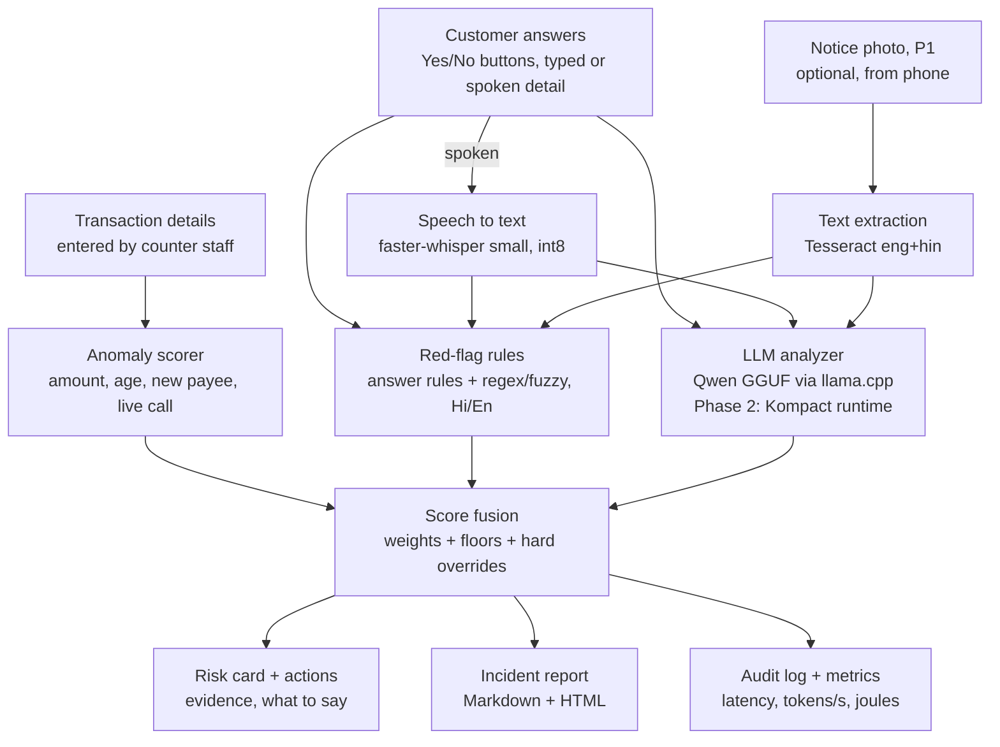

# Counter Kavach — End-to-End Build Plan

Oct 30, 2026 · @Avinash · v2 (review fixes applied; see "Changes from the PDF version" at the end)

## Goal and success criteria

Ship a working, offline, CPU-only prototype of Counter Kavach in a public GitHub repo and submit the Build Next form by Sun 1 Nov 2026, 6 PM IST (form closes 1 Nov). Aim to submit by 3 PM IST to leave a buffer.

**One-liner:** an offline copilot that helps bank counter staff spot coercion ("digital arrest" and impersonation scams) before a large withdrawal or transfer, and records an SOP-ready incident note.

**Users:** counter staff and the branch manager. The customer is often a senior citizen being coached on a live call.

**Done means:**

- `make setup && make models && make run` works on Linux/macOS, and `python tasks.py setup|models|run` works on Windows; no GPU; after the model download the app makes no network calls.
- One full check (intake → guided questions → risk card → report) uses under 60 s of **machine time** on CPU (sum of stage timings; excludes the time people spend answering), with the LLM step under 20 s (targets; report what you measure).
- `make eval` prints, as counts and percentages:
  - scam scenarios flagged MEDIUM or HIGH — target ≥ 90% (≥ 22 of 24)
  - genuine scenarios flagged HIGH — target ≤ 10% (≤ 1 of 16)
  - genuine scenarios flagged MEDIUM or HIGH — target ≤ 30% (≤ 4 of 16), so "always MEDIUM" cannot pass
- README has a demo GIF or video, architecture image, eval table and CPU numbers.
- A 2-minute demo video link is ready for the form.

**Non-goals:** no bank-system integration, no real customer data, no claim that a document is genuine, and the tool never blocks a transaction by itself.

## Scope and weekend timeline

Build the P0 list first; notice OCR and PDF export are stretch goals that only start once the P0 flow runs end to end.

| Priority | Feature | Module |
|---|---|---|
| P0 | Transaction intake + anomaly score | `anomaly.py` |
| P0 | Guided interview, English + Hindi, Yes/No/Unsure buttons + detail text | `interview.py` |
| P0 | Red-flag rules engine (answer rules + text rules) | `rules/engine.py` |
| P0 | Local LLM analyzer with JSON output + evidence guard | `analyzer.py` |
| P0 | Score fusion (weights, floors, overrides) + risk card + recommended actions | `fusion.py`, `actions.py` |
| P0 | Incident report export (Markdown + HTML) | `report.py` |
| P0 | CPU metrics sidebar (latency, tokens/s, energy) | `metrics.py` |
| P0 | 40 synthetic scenarios + eval script | `eval/` |
| P0, time-boxed 2 h | Voice answers (speech to text) for Q1 and detail text | `asr.py` |
| P1 | Fake-notice cue check from a photo (OCR) | `notice_check.py` |
| P1 | Hash-chained audit log, PDF export | `audit.py`, `report.py` |
| P2 | Kompact AI Runtime backend, more languages | Phase 2 |

**Friday 30 Oct, evening (about 4 h)**

- [ ] Python 3.11 conda env + `llama-cpp-python` installed **first** (see "Setup on the reference laptop"); stop and fix before anything else
- [ ] Repo scaffold, `tasks.py` + Makefile, requirements, model download script
- [ ] LLM backend wrapper returning schema-valid JSON on CPU; smoke test prints JSON, tokens/s and LLM seconds → pick the model (rule in "Tech stack")
- [ ] Rules YAML + engine + unit tests
- [ ] Resume PDF ready (form item; don't leave it for Sunday)

**Saturday 31 Oct (about 10 h)**

- [ ] Write all 40 synthetic scenarios (LLM-drafted is fine, every one hand-reviewed) and **commit them before tuning anything**
- [ ] Question bank + interview flow
- [ ] Analyzer prompt, evidence guard, fusion, risk card
- [ ] Actions + customer-message templates + incident report export
- [ ] Streamlit UI with 3 demo scenarios + metrics sidebar
- [ ] `make eval` + `make bench`; tune weights on the dev split only
- [ ] Voice answers (stop at 2 h; typed + buttons stay the fallback)

**Sunday 1 Nov (about 8 h)**

- [ ] Stretch: notice OCR check
- [ ] README, architecture image, eval and CPU tables
- [ ] Record and upload the 2-minute demo
- [ ] Push the public repo and submit the form (target 3 PM, hard stop 6 PM IST)

**If behind, cut in this order:** notice OCR → PDF export → voice (buttons + typing stay) → shrink eval to 20 scenarios. Never cut the eval table or the README; reviewers judge the repo.

## Architecture

Twelve components run in one Python process on the branch PC; the only model files are a GGUF LLM, a Whisper model and Tesseract language data.



Button answers, typed or transcribed detail and any notice text feed both the rules and the LLM; fusion adds the anomaly score and returns one explainable risk level, which drives the risk card, the report and the audit log. Rules render first, so obvious cases show a preliminary card while the LLM finishes.

## Tech stack and models

Python 3.11 on CPU only, with every model loaded from local files; pick model families Kompact already supports (Qwen, Llama, Phi) so the Phase 2 port is a backend swap.

| Layer | Choice | Fallback |
|---|---|---|
| UI | Streamlit ≥ 1.40 (`st.audio_input` for voice) | — |
| LLM runtime | `llama-cpp-python`, GGUF, JSON-schema constrained output | Phase 2: Kompact AI Runtime |
| LLM model | **Qwen3-4B-Instruct-2507**, Q4_K_M GGUF (about 2.5 GB). Not the original hybrid Qwen3-4B: it emits `<think>` blocks that break the schema and add latency | Qwen2.5-1.5B-Instruct Q4_K_M (8 GB machines, or if the 4B is too slow) |
| Validation | Pydantic v2 models | — |
| Speech to text | `faster-whisper` small, int8, VAD on, `language="hi"` or `"en"`, loaded from a local directory | text input only |
| OCR (P1) | Tesseract 5 + `pytesseract`, `eng+hin` | skip notice check |
| Rules | YAML + `re` + `rapidfuzz` for Hinglish spellings | — |
| Reports | Jinja2 → Markdown + HTML; `fpdf2` with Noto Sans Devanagari for PDF (P1) | Markdown only |
| Metrics | `time.perf_counter`, `psutil`, Linux RAPL energy counters | TDP-based estimate, labelled "estimated" |
| Tests | `pytest` | — |

**Model choice rule (Friday night):** run the analyzer prompt on demo scenario 1 with the 4B model. If the LLM step takes more than 25 s, switch `llm_path` to the 1.5B fallback and record the numbers and the decision in `DECISIONS.md`. Record the exact GGUF repo and file name in `config.yaml` and the README.

**Hardware assumed:** x86-64 laptop, 8+ cores, 16 GB RAM, no GPU. Works offline after `make models`.

**Licenses:** confirm each model's license on its model card before committing (prefer Apache-2.0 or MIT) and list them in the README. Models and datasets are downloaded by script, never committed.

### Setup on the reference laptop (Windows 11, AMD Ryzen 7 250, 8 cores / 16 threads, 15 GB RAM)

- System Python is 3.14; wheels for `llama-cpp-python` / `ctranslate2` may not exist for it. Use the existing miniconda: `conda create -n kavach python=3.11 -y`, then `conda activate kavach`.
- `llama-cpp-python`: try the prebuilt CPU wheel first: `pip install llama-cpp-python --prefer-binary --extra-index-url https://abetlen.github.io/llama-cpp-python/whl/cpu`. If no wheel matches, it builds from source and needs Visual Studio 2022 Build Tools (C++ workload) and CMake. This is the biggest setup risk; do it first.
- No `make` on this machine: `tasks.py` implements every target (`setup`, `models`, `run`, `test`, `eval`, `bench`) and the Makefile is a thin wrapper over it for Linux/macOS reviewers.
- RAPL energy counters are Linux-only, so energy on this laptop is always the labelled estimate (`cpu_tdp_watts` in config).
- `n_threads` = physical cores (`psutil.cpu_count(logical=False)`, 8 here).
- Tesseract is not installed; only needed for the P1 notice check.
- Keep code cross-platform: `pathlib` everywhere, no shell-specific commands in Python.

## Repository structure

One Python package (`kavach/`) holds all logic so the Streamlit app stays thin and the eval scripts reuse the same code path.

```
counter-kavach/
├── README.md
├── PLAN.md                      # this file
├── LICENSE                      # MIT
├── DECISIONS.md                 # choices made where this plan was ambiguous
├── Makefile                     # Linux/macOS wrapper over tasks.py
├── tasks.py                     # setup, models, run, test, eval, bench (cross-platform)
├── requirements.txt
├── config.yaml                  # thresholds, weights, floors, overrides, model paths, branch name
├── .streamlit/
│   └── config.toml              # browser.gatherUsageStats = false
├── app/
│   ├── main.py                  # Streamlit entry, 5-step wizard, sidebar; installs offline guard first
│   └── components.py            # risk badge, evidence list, metrics panel
├── kavach/
│   ├── schemas.py               # Pydantic models (all I/O)
│   ├── anomaly.py
│   ├── interview.py
│   ├── textnorm.py              # NFC, casefold, whitespace, abbreviation dots, negation cues
│   ├── rules/
│   │   ├── red_flags.yaml
│   │   └── engine.py
│   ├── llm/
│   │   ├── backend.py           # LLMBackend interface
│   │   ├── llamacpp_backend.py
│   │   ├── kompact_backend.py   # stub, raises NotImplementedError
│   │   └── prompts/             # analyzer.md, notice.md
│   ├── analyzer.py
│   ├── fusion.py
│   ├── actions.py               # reads actions.yaml
│   ├── actions.yaml             # actions per level + customer-message templates (EN/HI)
│   ├── report.py                # + templates/
│   ├── notice_check.py          # P1
│   ├── asr.py                   # P0, time-boxed
│   ├── privacy.py               # masking + offline guard
│   ├── audit.py
│   └── metrics.py
├── data/
│   ├── question_bank.yaml
│   ├── scenarios/               # synthetic JSON cases (dev + test splits)
│   └── samples/                 # synthetic notice images, marked SAMPLE
├── eval/
│   ├── run_eval.py
│   ├── bench.py
│   └── results/                 # generated, committed for the README
├── scripts/
│   ├── download_models.py
│   └── make_scenarios.py
├── tests/
└── docs/                        # architecture.png, demo.gif
```

`.gitignore` must exclude `models/`, `var/` (local logs, reports, LLM cache) and any downloaded datasets.

## Configuration (`config.yaml` sketch)

Every threshold, weight, floor and override lives here so tuning never touches code.

```yaml
branch: "Demo Branch (synthetic)"
offline: true
retention_days: 30

models:
  llm_path: models/llm/qwen3-4b-instruct-2507-q4_k_m.gguf
  llm_fallback_path: models/llm/qwen2.5-1.5b-instruct-q4_k_m.gguf
  whisper_dir: models/whisper-small

llm:
  n_ctx: 4096
  n_threads: auto            # physical cores
  temperature: 0.1
  max_tokens: 384

asr:
  max_clip_seconds: 10
  min_avg_logprob: -1.0

anomaly:
  min_check_amount_inr: 50000   # below this, only "Check anyway" starts the guided check
  trigger_score: 30
  ratio_points: [[10, 30], [5, 20], [3, 10]]
  senior_age: 60
  senior_points: 15
  new_beneficiary_points: 15
  large_transfer_inr: 500000
  large_transfer_new_payee_points: 10
  above_max_single_debit_factor: 2
  above_max_single_debit_points: 10
  fd_break_points: 10
  on_call_points: 20
  unknown_companion_points: 10

rules:
  fuzzy_threshold: 90
  fuzzy_min_term_len: 5
  negation_window_before: 4     # tokens
  negation_window_after: 3      # tokens, Hindi negators only
  unsure_factor: 0.5

llm_scoring:
  likelihood_scores: {low: 10, medium: 50, high: 85}
  no_evidence_cap: 30
  evidence_match_threshold: 85  # rapidfuzz partial_ratio

fusion:
  weights: {anomaly: 0.25, rules: 0.35, llm: 0.40}
  levels: {medium: 35, high: 65}
  overrides_high:
    - name: authority_plus_coercion
      rules_all: [AUTHORITY_IMPERSONATION]
      rules_any: [DIGITAL_ARREST, TRANSFER_FOR_VERIFICATION, ARREST_THREAT, SECRECY_INSTRUCTION]
    - name: live_call_authority_instructed
      rules_all: [LIVE_CALL, AUTHORITY_IMPERSONATION, INSTRUCTED_PAYMENT]
  floors_medium:
    - name: live_call_large_new_payee
      when: {live_call: true, beneficiary_is_new: true, min_amount_ratio: 5}
    - name: secrecy_instruction
      rules_all: [SECRECY_INSTRUCTION]

metrics:
  cpu_tdp_watts: 28            # set from your CPU's spec sheet; used only when RAPL is unavailable

eval:
  llm_cache_dir: var/llm_cache
```

## Module specs

Each module takes and returns the Pydantic models below.

### 1. Anomaly scorer (`anomaly.py`)

Input `TransactionContext`: `customer_age`, `avg_monthly_debit_inr` (last 6 months), `max_single_debit_inr_12m`, `txn_amount_inr`, `txn_type` (CASH, RTGS, NEFT, IMPS, FD_BREAK, DD, OTHER), `beneficiary_is_new`, `customer_on_call_at_counter`, `accompanied_by_unknown_person`, `staff_notes`. In production the debit history comes from the core banking system; in the prototype staff type it or load a demo scenario.

Output `AnomalyResult{score 0–100, amount_ratio, reasons: list[str], check_recommended: bool}`. Default points (configurable):

| Signal | Points |
|---|---|
| Amount ÷ max(avg monthly debit, ₹1) ≥ 10 / ≥ 5 / ≥ 3 | 30 / 20 / 10 |
| Amount ≥ 2 × largest single debit in the last 12 months | 10 |
| Customer age ≥ 60 | 15 |
| New beneficiary | 15 |
| RTGS/NEFT/IMPS ≥ ₹5 lakh to a new beneficiary | 10 |
| Premature FD break | 10 |
| Customer on a phone or video call at the counter | 20 |
| Accompanied by an unknown person | 10 |

Cap at 100. Recommend the guided check when score ≥ 30 **and** amount ≥ `min_check_amount_inr` (₹50,000), or when staff click "Check anyway". Without the amount gate, age ≥ 60 plus any new payee (15 + 15) would trigger ten questions for a ₹2,000 payment.

### 2. Guided interview (`interview.py`, `data/question_bank.yaml`)

Ten base questions, each with `id`, `en`, `hi`, `type` (`open` or `yes_no`), `risk_answer` (the choice that is a red flag), `probes` (shown when the risk answer is chosen) and an optional `branch_to` (Q9 yes → notice check, P1; if it isn't built, the answer is just recorded). Ask one at a time, calm and non-accusatory.

Q1 is open text. Q2–Q10 get **Yes / No / Unsure / Skip buttons plus an optional detail box** (typed or spoken). Button answers are scored deterministically, so a customer who says "No, nobody from police called" can't trigger an authority rule by repeating the question's keywords.

| ID | Topic | English | Hindi | Risk answer |
|---|---|---|---|---|
| Q1 | purpose | What is this money for? | यह पैसा किस काम के लिए है? | open |
| Q2 | instructed | Did anyone ask or tell you to make this payment? | क्या किसी ने आपसे यह भुगतान करने को कहा है? | Yes |
| Q3 | payee | Do you personally know who is receiving it? | क्या आप पैसा पाने वाले व्यक्ति को निजी तौर पर जानते हैं? | No |
| Q4 | authority | Has anyone said they are from police, CBI, ED, customs, RBI, a court or a courier company? | क्या किसी ने खुद को पुलिस, सीबीआई, ईडी, कस्टम, आरबीआई, कोर्ट या कूरियर कंपनी से बताया है? | Yes |
| Q5 | secrecy | Were you told not to tell family or bank staff? | क्या आपसे कहा गया है कि परिवार या बैंक कर्मचारियों को न बताएं? | Yes |
| Q6 | live call | Are you on a call or video call with them now? | क्या आप अभी उनसे फ़ोन या वीडियो कॉल पर हैं? | Yes |
| Q7 | refund promise | Were you told the money will come back after verification? | क्या आपसे कहा गया है कि जांच के बाद पैसा वापस मिल जाएगा? | Yes |
| Q8 | threat | Were you told you will be arrested or your account frozen if you don't pay today? | क्या आपसे कहा गया है कि आज भुगतान नहीं किया तो आपको गिरफ्तार किया जाएगा या खाता फ्रीज़ हो जाएगा? | Yes |
| Q9 | documents | Did you receive a notice, warrant or order on WhatsApp or email? | क्या आपको व्हाट्सऐप या ईमेल पर कोई नोटिस, वारंट या आदेश मिला है? | Yes |
| Q10 | family | May we call a family member before we process this? | क्या इसे आगे बढ़ाने से पहले हम आपके परिवार के किसी सदस्य को फ़ोन कर सकते हैं? | No |

Probes (no LLM call; answers go into that question's detail text):

| On | English | Hindi |
|---|---|---|
| Q2 Yes | Who asked you? How do you know them? | किसने कहा? आप उन्हें कैसे जानते हैं? |
| Q4 Yes | Which office? Did they give a name or case number? | कौन-सा विभाग? क्या उन्होंने कोई नाम या केस नंबर बताया? |
| Q6 Yes | Since when? Is the camera on? | कब से? क्या कैमरा चालू है? |
| Q7 Yes | Who said it will come back, and when? | किसने कहा कि पैसा वापस आएगा, और कब? |
| Q9 Yes | Can you show it to us? | क्या आप हमें वह दिखा सकते हैं? |

There are no LLM-generated follow-up questions: they would cost a second LLM call per check. Show staff tips beside the questions: scam victims are often told to lie, so note inconsistencies rather than argue. If a HIGH override already fires before Q10 (for example Q4 and Q8 both Yes), show an "Enough to escalate → risk card" button so staff don't have to finish all ten.

### 3. Speech to text (`asr.py`)

`faster-whisper` small, int8, `vad_filter=True`, language hint `hi` or `en`, model loaded from `models/whisper-small` (a local path, never a model name, so it never contacts the Hugging Face Hub). Return `Transcript{text, language, avg_logprob, seconds}`. Show the transcript in an editable box; staff confirm it before analysis.

Voice is used for Q1 and the detail boxes: each has a mic button (`st.audio_input`), each clip is transcribed on its own and shown for staff to confirm. If a clip takes over 10 s to transcribe or `avg_logprob` falls below −1.0 (configurable), prompt staff to type that answer instead. Audio is processed in memory and never written to disk.

In Hindi mode Whisper writes English loanwords in Devanagari ("सीबीआई", "डिजिटल अरेस्ट", "वेरिफिकेशन"), so every rule needs those spellings. If `small` is too weak on Hindi and CPU time allows, try `medium` int8 and record the timing in `DECISIONS.md`.

### 4. Red-flag rules (`rules/red_flags.yaml`, `rules/engine.py`, `textnorm.py`)

There are two kinds of rule, sharing one id space; **each rule id counts once** (at its highest weight):

- **Answer rules:** a button choice on a question (for example Q4 = Yes) hits the rule. `Unsure` counts at `unsure_factor` (half weight) and never satisfies a floor or override. `Skip` counts as nothing.
- **Text rules:** case-insensitive regex in English, Devanagari and romanised Hindi, plus optional `fuzzy_terms` matched with `rapidfuzz.partial_ratio ≥ 90` (only for terms of 5+ characters). Regexes run on Q1, `staff_notes`, notice text, and the detail text of questions answered Yes or Unsure.

**Text normalisation before matching (`textnorm.py`):** Unicode NFC, casefold, collapse whitespace, and strip periods inside abbreviations (`c.b.i.` → `cbi`, `सी.बी.आई.` → `सीबीआई`).

**Word boundaries:** use `\b` only in Latin patterns. Never put `\b` around Devanagari: Python treats vowel signs (matras) as non-word characters, so `\b` fires inside Devanagari words.

**Negation:** ignore a text match if a negation cue (`no`, `not`, `nobody`, `never`, `nahi`, `nahin`, `mat`, `नहीं`, `कोई नहीं`) appears within 4 tokens before it, or a Hindi negator (`nahi`, `nahin`, `नहीं`) within 3 tokens after it. Rules can set `negatable: false`.

Patterns use YAML single quotes so `\b` stays literal; a literal `'` inside is written `''`.

```yaml
rules:
  - id: AUTHORITY_IMPERSONATION
    label_en: Someone claimed to be police / CBI / ED / RBI / court
    label_hi: किसी ने खुद को पुलिस / सीबीआई / ईडी / आरबीआई / कोर्ट से बताया
    weight: 25
    answer: {question: Q4, on: yes}
    patterns:   # an agency name alone is not enough; it needs a role or claim
      - '\b(cbi|ed|enforcement directorate|ncb|narcotics|customs|cyber ?crime|police|rbi|trai|court)\b ?(officer|official|inspector|wala|wale|waale|se)\b'
      - '\b(officer|official|inspector|agent)s? (from|of) (the )?(cbi|ed|enforcement directorate|ncb|narcotics|customs|cyber ?crime|police|rbi|trai|supreme court|high court)\b'
      - '\b(said|says|claimed|claims|told me) (he|she|they) (is|was|are|were) (from )?(the )?(cbi|ed|enforcement directorate|ncb|customs|cyber ?crime|police|rbi|trai|court)\b'
      - '(सी\s?बी\s?आई|पुलिस|ईडी|कस्टम्स?|आरबीआई|साइबर क्राइम|कोर्ट)\s?(अधिकारी|ऑफिसर|इंस्पेक्टर|वाले|वाला|से)'

  - id: DIGITAL_ARREST
    label_en: Told they are under "digital arrest" / must stay on video call
    label_hi: "डिजिटल अरेस्ट" या वीडियो कॉल पर बने रहने को कहा गया
    weight: 30
    patterns:
      - 'digital ?arrest|house ?arrest'
      - '\b(camera|video) (on|chalu) (rakh|rakho|rakhna|rakhiye)\b|video ?call (pe|par) (raho|rehna|rahna|rahiye)'
      - '\b(stay|remain|keep) on (the )?video ?call\b|\b(don''?t|do not) (disconnect|cut|end) the (video )?call\b'
      - 'डिजिटल\s?अरेस्ट|हाउस\s?अरेस्ट|वीडियो\s?कॉल\s?(पर|पे)\s?(रहो|रहना|रहिए)|कैमरा\s?(ऑन|चालू)\s?(रखो|रखना|रखिए)'

  - id: SECRECY_INSTRUCTION
    label_en: Told not to tell family or bank staff
    label_hi: परिवार या बैंक को न बताने को कहा गया
    weight: 20
    answer: {question: Q5, on: yes}
    patterns:   # bare "secret" / "confidential" removed: surprises and gifts are genuine
      - '\b(don''?t|do not|never|not to) tell (anyone|anybody|your family|family|your (son|daughter|children|wife|husband)|the bank|bank (staff|officials?|people))\b'
      - '\bkeep (it|this) (secret|confidential) from\b'
      - 'kisi ko (bhi )?(mat|na|nahi|nahin) (batana|batao|bataiye|bataye)|ghar (par|pe|mein) (mat|na) (batana|batao)'
      - 'किसी को (भी )?(मत|न|नहीं) (बताना|बताओ|बताइए|बताएं)|घर (पर|पे|में) (मत|न) (बताना|बताओ)'

  - id: TRANSFER_FOR_VERIFICATION
    label_en: Told to move money to a "safe" account for verification
    label_hi: जांच के लिए पैसा "सुरक्षित खाते" में डालने को कहा गया
    weight: 25
    answer: {question: Q7, on: yes}
    patterns:   # bare "verification for" removed: it matched "police verification for my passport"
      - '\bsafe (custody|account)\b|\b(rbi|government|sarkari|secure) (account|khata|khate)\b'
      - '\b(transfer|send|deposit|move|park|bhej\w*|daal\w*|jama)\b.{0,30}\b(for|ke liye) (verification|jaanch|janch|checking|investigation)\b'
      - '\b(refund|return)(ed)? after (verification|investigation|checking|clearance)\b|\bmoney will (come|be (sent|given|returned)) back\b'
      - '\b(paisa|paise) wapas (aa|mil) (jayega|jayenge|jaega)\b'
      - 'सुरक्षित (खाते|खाता|अकाउंट)|(आरबीआई|सरकारी) (खाते|खाता|अकाउंट)|(पैसा|पैसे|रकम) वापस (आ|मिल) (जाएगा|जाएंगे|जायेगा)'
```

Also add (text patterns in English, romanised Hindi and Devanagari, including Devanagari spellings of English loanwords):

| Rule id | Weight | Answer rule | Example terms |
|---|---|---|---|
| `PARCEL_OR_DRUGS` | 25 | — | parcel/courier with drugs, MDMA, fake passports; "aapke naam ka parcel"; पार्सल, ड्रग्स |
| `LAUNDERING_ACCUSATION` | 25 | — | money laundering, hawala, Aadhaar or SIM misused in a crime; मनी लॉन्ड्रिंग, आधार का गलत इस्तेमाल |
| `ARREST_THREAT` | 25 | Q8 Yes | arrest warrant, will be arrested, jail, giraftar; अरेस्ट वारंट, गिरफ्तार, जेल |
| `URGENCY` | 10 | — | today itself, within 2 hours, immediately, abhi ke abhi, aaj hi; आज ही, तुरंत |
| `INVESTMENT_LURE` | 20 | — | guaranteed return, double money, IPO allotment, trading app, WhatsApp/Telegram group; गारंटीड रिटर्न, पैसा डबल |
| `KYC_OR_ACCOUNT_BLOCK` | 20 | — | KYC update, account will be blocked/frozen, PAN update link; केवाईसी, खाता बंद, फ्रीज़ |
| `RELATIVE_IN_TROUBLE` | 20 | — | son/grandson arrested, accident, hospital abroad, needs money urgently; बेटा/पोता गिरफ्तार, अस्पताल |
| `LIVE_CALL` | 15 | Q6 Yes | no text patterns; also hit by the `customer_on_call_at_counter` transaction flag |
| `INSTRUCTED_PAYMENT` | 15 | Q2 Yes | — |
| `UNKNOWN_PAYEE` | 10 | Q3 No | — |
| `NOTICE_RECEIVED` | 10 | Q9 Yes | — |
| `DECLINES_FAMILY_CALL` | 10 | Q10 No | — |

Output `RuleHit{rule_id, weight, matched_text, source, via}` where `source` is a question id, `notice`, `staff_notes` or `transaction`, and `via` is `answer` or `text`. `rule_score = min(100, sum(weights))`, each rule id counted once.

**Unit tests:** a positive and a hard negative per text rule, plus these, which must not match the named rules:

- "police verification for my passport" → no `AUTHORITY_IMPERSONATION`, no `TRANSFER_FOR_VERIFICATION`
- "court case over my land" / "my lawyer called about the high court hearing" → no `AUTHORITY_IMPERSONATION`
- "No, nobody from police or CBI called me" → no hit (negation)
- "keep it secret, it's a surprise for my daughter" → no `SECRECY_INSTRUCTION`
- "पुलिस वेरिफिकेशन पासपोर्ट के लिए" → no `TRANSFER_FOR_VERIFICATION`

### 5. LLM analyzer (`analyzer.py`, `prompts/analyzer.md`)

Output schema `LLMAssessment` (kept small; output tokens dominate CPU latency):

```json
{
  "coercion_likelihood": "low | medium | high",
  "scam_type": "digital_arrest | investment | kyc_or_account_block | relative_in_trouble | lottery_or_refund | other | none_detected",
  "red_flags": [{"flag": "", "evidence": "verbatim quote from an answer", "question_id": "Q4"}],
  "inconsistencies": [""],
  "staff_summary": "≤ 40 words, staff language"
}
```

Limits: at most 5 `red_flags`, each `evidence` ≤ 20 words, copied in the answer's **original language and script** (never translated); at most 3 `inconsistencies`. There is no numeric score and no customer message in the schema: a 0–100 number from a 4B model is noisy, and words said to a possibly frightened customer come from reviewed templates in `actions.yaml`, not from the model.

Input to the prompt: a short transaction summary, then each answer as `Q4 [Yes]: <detail>`. Keep the system prompt under about 350 tokens. It must state: you assist bank branch staff; Indian agencies do not arrest people over video calls or ask for money transfers to "verify" funds; customers may have been coached to lie, so note inconsistencies; quote evidence only from the answers given, verbatim; genuine large payments are common (property, wedding, hospital, education), so do not raise alarms without evidence; return JSON only.

Run with `temperature=0.1`, `max_tokens=384`, `n_ctx=4096`, `n_threads` = physical cores, schema-constrained output (`response_format` with a JSON schema). Exactly **one LLM call per check**. Validate with Pydantic; on failure retry once, then fall back to a result without the LLM, marked "LLM unavailable".

**LLM score:** `llm_score = likelihood_scores[coercion_likelihood]` (low 10, medium 50, high 85).

**Evidence guard:** normalise both sides (`textnorm`), then keep a `red_flag` only if its `evidence` is an exact substring of the cited answer (or of any answer when `question_id` is missing), or `rapidfuzz.fuzz.partial_ratio ≥ 85`. Use `partial_ratio`, not `ratio`: a short quote against a long answer scores low on `ratio`, so valid evidence would be dropped. If no red flags survive, cap `llm_score` at `no_evidence_cap` (30), so a made-up "high" with no evidence cannot drive the result. Log how many flags were dropped.

### 6. Score fusion (`fusion.py`)

`final = Σ wᵢ × scoreᵢ / Σ wᵢ` over the **available** components: anomaly, rules and llm, with weights 0.25 / 0.35 / 0.40 from config. If the LLM is unavailable, the remaining weights are re-normalised. The rules-only and LLM-only ablations use the same re-normalisation.

Levels: below 35 LOW, 35–64 MEDIUM, 65+ HIGH. Then apply, from config:

- **Hard overrides to HIGH:**
  - `AUTHORITY_IMPERSONATION` together with any of `DIGITAL_ARREST`, `TRANSFER_FOR_VERIFICATION`, `ARREST_THREAT` or `SECRECY_INSTRUCTION`
  - `LIVE_CALL` + `AUTHORITY_IMPERSONATION` + `INSTRUCTED_PAYMENT`: someone claiming authority told them to pay and is on the call now
- **Floors to at least MEDIUM:**
  - on a live call (transaction flag or Q6 Yes) **and** new beneficiary **and** amount ratio ≥ 5. Coached victims deny everything; without this floor the anomaly score, worth at most 25 fused points, can never escalate the classic case alone.
  - `SECRECY_INSTRUCTION` hit

Only full hits count for floors and overrides (not `Unsure`).

Output `RiskAssessment{level, score, scam_type, evidence[], overrides_applied[], floors_applied[], component_scores, llm_available}`. Each evidence item carries a source tag (Transaction, Answer, Rule, LLM, Notice) so staff see why. Show the top 5.

**Worked examples (write these as tests):**

| Case | Anomaly | Rules | LLM | Fused | Result |
|---|---|---|---|---|---|
| A. Candid digital arrest: age 72, ₹18 lakh RTGS, new payee, on video call, Q2/Q4/Q5/Q7/Q8 Yes | 100 | 100 | 85 | 94 | HIGH (override) |
| B. Coached victim: same transaction, answers "No" with a cover story ("buying a flat"), Q10 Yes | 100 | 15 | 10 | 34.3 | **MEDIUM via floor** (LOW without it) |
| C. Genuine wedding: age 62, ₹12 lakh RTGS to new venue payee, not on a call, no risk answers | 80 | 0 | 10 | 24 | LOW |
| D. Passport hard negative: Q4 Yes "police came for my passport verification", no coercion | 15 | 25 | 10 | 16.5 | LOW (no override) |
| A without LLM | 100 | 100 | — | 100 | HIGH |
| B without LLM | 100 | 15 | — | 50.4 | MEDIUM |

Assumptions:
- A and B: average monthly debit ₹40,000, largest single debit ₹1.5 lakh; B's only rule hit is `LIVE_CALL`, from the transaction flag.
- C: average monthly debit ₹60,000, largest single debit ₹2 lakh.
- D: age 45, ₹60,000 NEFT to a new payee, average monthly debit ₹50,000; staff clicked "Check anyway".

### 7. Notice cue check, P1 (`notice_check.py`)

OCR the photo (`eng+hin`), then flag cues with rules + LLM (`prompts/notice.md`): arrest and payment demand in one document; secrecy demand; several agencies on one page (for example CBI, RBI and a court together); a personal bank account or UPI ID for "deposit"; WhatsApp or video call as the channel; deadlines in hours; missing case number. Output wording is always "suspicious cues found, verify through official channels", never "genuine" or "fake". Demo samples are synthetic text images marked SAMPLE, with no real logos, emblems or seals.

### 8. Recommended actions (`actions.py`, `actions.yaml`)

| Level | Recommended actions |
|---|---|
| LOW | Proceed; hand over a short scam-awareness note |
| MEDIUM | Supervisor review before processing; offer to call a family contact with consent; suggest a cooling-off period; re-check |
| HIGH | Do not process now; escalate to the branch manager; apply a temporary debit hold if the bank's SOP allows; help the customer report on 1930 or cybercrime.gov.in; inform police per bank policy |

Keep the wording in `actions.yaml` so a bank can match its own SOP. The tool recommends; an authorised officer decides, and the UI records the decision.

`actions.yaml` also holds the **customer messages**: reviewed EN + HI templates keyed by `scam_type` and level (plus one generic LOW note), each ≤ 40 words, calm and non-accusatory. Example for `digital_arrest`:

- EN: "You are safe here. No police or government agency arrests anyone on a video call or asks you to move money to verify it. Please end the call — we will help you."
- HI: "आप यहाँ सुरक्षित हैं। कोई भी पुलिस या सरकारी एजेंसी वीडियो कॉल पर गिरफ्तार नहीं करती और न ही जांच के लिए पैसे ट्रांसफर करवाती है। कृपया कॉल काट दें, हम आपकी मदद करेंगे।"

### 9. Incident report (`report.py`)

`IncidentNote`: id, timestamp, branch, staff name, masked customer reference, transaction summary (amount, type, payee), anomaly reasons, Q&A transcript (button choice + detail), evidence with sources, level and score, overrides and floors applied, recommended and chosen actions, staff notes, model names and versions, stage timings. Export Markdown and HTML (PDF in P1), plus a 5-line plain-text summary staff can paste into a cybercrime complaint.

### 10. Privacy and audit (`privacy.py`, `audit.py`)

- **Customer identifiers** (their account numbers, Aadhaar, PAN) are always masked: account numbers to the last 4 digits; Aadhaar and PAN patterns masked before anything is written to `var/`.
- **Suspect identifiers** (the payee account or UPI ID, and any caller phone numbers) are kept in full only when the officer marks the case "suspected fraud", because the complaint needs them; otherwise they are masked.
- Append every check to `var/audit.jsonl`; in P1 add a SHA-256 hash chain so edits are detectable. Retention days come from config.

## UI flow

The app is a five-step wizard driven by `st.session_state`, with a fixed sidebar; staff can finish a check without scrolling on a 1366×768 screen.

1. **Intake:** transaction form, a "Load demo scenario" dropdown (3 scenarios: digital arrest, investment scam, genuine wedding payment), anomaly score with its reasons, buttons "Start guided check" and "Check anyway".
2. **Guided check:** one question at a time, EN/HI toggle, Yes / No / Unsure / Skip buttons, a detail box with a mic button, probes on risk answers, progress bar, an "Enough to escalate" shortcut when an override already fires, then "Analyse".
3. **Notice check (optional, P1):** upload a photo, show the extracted text and the cues with quotes.
4. **Risk card:** the rules + anomaly result renders first as a preliminary card (in an `st.empty()` placeholder), then the LLM result replaces it. A large LOW / MEDIUM / HIGH badge (status colours), score, scam type, top 5 evidence items with source chips, overrides/floors applied, "What to say to the customer" from the templates in their language, recommended actions as a checklist, a required "Action taken" select and a "Suspected fraud" checkbox.
5. **Report:** preview, download Markdown and HTML (PDF in P1), copy the complaint summary, "New check".

**Sidebar:**
- an "Offline" badge (green only when the network guard is on)
- model names and quantisation; CPU model and cores
- per-stage latency for the last check, tokens/s
- energy per check (marked "estimated" when RAPL is unavailable)
- "Reset"

Load models once with `st.cache_resource`; show a spinner with the stage name while each step runs.

## Data and evaluation

The headline eval is 40 hand-reviewed synthetic counter scenarios; public datasets only sanity-check the rules engine and stay optional.

**Synthetic scenarios (`scripts/make_scenarios.py` → `data/scenarios/*.json`):**
- Each file holds a `TransactionContext`, answers keyed by question id (`{"choice": "yes|no|unsure|skip", "detail": "..."}`; Q1 has only `detail`), a label `{is_scam, scam_type, coached}` and `split: dev|test` (20 / 20, stratified by group).
- Mix English, Hindi (Devanagari) and Hinglish answers.
- Drafting with an LLM is fine; hand-review and edit every scenario.

| Group | Count | Examples |
|---|---|---|
| Digital arrest | 10 | "CBI officer" on video call, parcel with drugs, Aadhaar misuse, "safe RBI account" |
| Investment scam | 5 | WhatsApp trading group, guaranteed returns, IPO allotment |
| KYC or account block | 4 | "account will be frozen today", PAN update link |
| Relative in trouble | 3 | grandson arrested, hospital emergency abroad |
| Lottery or refund | 2 | tax refund fee, prize processing charge |
| Genuine | 16 | property, wedding, hospital bill, school fees, FD moved to another bank, vehicle, supplier payment |

- **At least 5 of the 24 scam cases are coached** (`coached: true`): the customer denies everything or gives a cover story, so the only signals are the transaction, the live call and inconsistencies.
- Include hard negatives among the genuine cases: "police verification for my passport", "court case over my land", "son abroad needs fees" with a known payee, and an elderly customer on a phone call with their son while paying a new payee (expect MEDIUM; that counts toward the genuine MEDIUM budget).
- Do not copy text from real complaints; write scenarios fresh.
- **Commit all 40 scenarios before tuning any rule or weight** (git history shows it), tune only on `dev`, and report `test`, `dev` and all 40 separately.

**Optional public data (check each license; download by script, never commit):**

- [Shade63/scam-classification-multiclass](https://huggingface.co/datasets/Shade63/scam-classification-multiclass): 14,000 Indian SMS and email messages with a government-impersonation class; use it to measure the text rules' impersonation precision and recall on message text.
- ICFD-31k: 31,000+ Indian conversational fraud transcripts (IJCAI 2026); use only if a download and license are available.

**Metrics: `eval/run_eval.py` writes `eval/results/summary.md`.** Report counts and percentages (n is small):

- Scam scenarios flagged MEDIUM or HIGH (recall) and flagged HIGH; coached scams reported separately
- Genuine scenarios flagged HIGH (false alarms) and MEDIUM or HIGH
- Ablation: rules only, LLM only, fused (re-normalised weights), plus trivial baselines "always MEDIUM" and "anomaly only", to show the targets aren't met by a trivial system
- Overrides and floors fired per scenario
- JSON validity rate and evidence-guard drops
- Per-stage latency p50 and p95

Report the numbers as measured, including misses; list each miss with one line on why.

**LLM cache:** eval caches LLM outputs in `var/llm_cache/`, keyed by model file, prompt hash and generation parameters, so re-running after tuning weights takes seconds; `NOCACHE=1` forces fresh calls. The benchmark never uses the cache.

## Privacy, offline guarantees and safety

Nothing about a customer leaves the machine, and the tool only advises: a person makes every decision.

- **Offline guard:** when `OFFLINE=1`, set `HF_HUB_OFFLINE=1` and `TRANSFORMERS_OFFLINE=1`, and wrap `socket.create_connection`, `socket.socket.connect` and `socket.getaddrinfo` so any non-localhost connection raises (allow `localhost`, `127.0.0.1` and `::1`). Install the guard before importing any model library: first lines of `app/main.py`, `eval/run_eval.py` and `eval/bench.py`. Add a test that proves an outbound call fails. The sidebar badge reads the guard's state.
- **Streamlit telemetry off:** `.streamlit/config.toml` sets `browser.gatherUsageStats = false`.
- **Synthetic data only** in the repo, demos and screenshots: invented names, account numbers that fail checksum, no real agency logos or seals.
- **Minimal data:** collect only the fields in `TransactionContext`; mask identifiers as in module 10 before writing; never store audio; delete `var/` files older than the configured retention days.
- **Human in the loop:** the app never blocks or approves a transaction. HIGH means "do not proceed without the manager"; the chosen action and the officer's name are recorded.
- **Fair use of signals:** age is the only personal attribute scored; never use religion, caste, gender, region or language as risk factors. Document this in the README.
- **Tone:** questions and customer messages stay calm and non-accusatory; the customer may be a victim under pressure.
- **Limits, shown in the UI footer and README:** prototype, not certified, not legal advice, cannot confirm whether a document is genuine.

## Performance and energy metrics

Measure every check, publish the numbers in the README, and label any estimate as an estimate; this is the "sustainable AI on CPU" proof Build Next is looking for.

- **Per stage (`metrics.py`):** anomaly ms, speech-to-text s per clip, rules ms, LLM s with prompt tokens, output tokens and tokens/s (prompt and generation), OCR s, total machine s.
- **Energy:** on Linux, read the RAPL powercap counter (`/sys/class/powercap/intel-rapl:0/energy_uj`, if present and readable) before and after the check, and document the `chmod` or `sudo` step. Elsewhere (including Windows), estimate it as average CPU utilisation × `cpu_tdp_watts` × seconds, and label it "estimated".
- **Benchmark (`eval/bench.py`, `make bench`):** run the 20 test-split scenarios with the cache off, then write a table with:
  - OS, CPU model, cores, RAM
  - model and quantisation
  - p50 and p95 latency (total and LLM)
  - tokens/s
  - joules per check (measured or estimated) and Wh per 1,000 checks
- **Speed-ups to apply:**
  - keep models loaded
  - one LLM call per check
  - a small output schema, `max_tokens` 384
  - reuse the system-prompt KV cache by keeping the prompt prefix identical
  - Q4_K_M, threads = physical cores
  - render the rules result before the LLM finishes

## Demo video script (2 minutes)

Show one scam caught and one genuine customer let through, on a laptop with Wi-Fi visibly off.

| Time | Show | Say |
|---|---|---|
| 0:00–0:15 | Title card | Digital-arrest scams drain savings; central systems can flag, but the money is stopped or lost at the branch counter. |
| 0:15–0:30 | Wi-Fi off, Offline badge, CPU info | Everything runs on an ordinary laptop CPU; no customer data leaves the branch. |
| 0:30–1:15 | Demo scenario 1: age 72, ₹18 lakh RTGS to a new payee; Yes/No taps plus a spoken Hindi answer for Q1 and the Q4 detail | Anomaly score, guided questions, HIGH risk, digital arrest, quoted evidence, actions, report. |
| 1:15–1:35 | Demo scenario 3: ₹12 lakh for a daughter's wedding | LOW risk, proceed; it does not cry wolf. |
| 1:35–1:50 | Sidebar metrics + eval table | Seconds per check, tokens/s, joules per check, recall and false-alarm rate. |
| 1:50–2:00 | Roadmap slide | Phase 2: Kompact AI Runtime, more Indian languages, post offices and CSCs. |

Record at 1080p with OBS or Loom; upload as unlisted YouTube or a Drive link set to "anyone with the link"; put the link at the top of the README.

## README and submission checklist

The README is the submission: a reviewer should understand the problem, see it work and trust the numbers in two minutes.

**README sections, in order:**

1. Title, one-liner, demo video link, demo GIF
2. Problem, with 2–3 cited sources (Supreme Court directions on digital arrest, a branch-intervention case); verify every citation
3. What it does: the 5 steps in one line each
4. Architecture image
5. Quick start: `make setup`, `make models`, `make run` (Windows: `python tasks.py setup|models|run`)
6. Offline and privacy guarantees
7. Models and licenses
8. Evaluation results (table from `eval/results/summary.md`; say the scenarios are synthetic and author-written)
9. CPU performance (table from `make bench`)
10. Limitations and safety
11. Roadmap: Kompact AI Runtime port
12. License (MIT)

**Form checklist (deadline 1 Nov 2026):**

- [ ] Repo is public and the URL opens while logged out
- [ ] README renders; video and GIF links work
- [ ] Resume ready as PDF
- [ ] "Working Professional", team size 1, own details in the member field
- [ ] Project description pasted, with any unbuilt feature removed
- [ ] Acknowledgement ticked, submitted, copy of responses received by email

## Phase 2 roadmap: Kompact AI Runtime

If selected (top 20 announced by 15 Nov), the 30-day build from 1 Dec swaps the inference backend to Kompact and turns the prototype into a multi-counter branch service.

**Design for the swap now:** `LLMBackend.generate(messages, json_schema, max_tokens, temperature) -> GenerationResult{text, prompt_tokens, output_tokens, seconds}`. `LlamaCppBackend` implements it today; `KompactBackend` is a stub until finalists receive runtime access. Prompts, schemas, evidence guard and eval stay identical, so before/after benchmarks are a fair comparison.

1. Week 1: port to Kompact, rerun `make eval` and `make bench`, publish the before/after table.
2. Week 2: more Indian languages (Marathi, Tamil, Telugu, Bengali) for questions and speech, using models Kompact supports.
3. Week 3: one branch server serving several counters, request batching, hash-chained audit log, admin view of daily checks.
4. Week 4: test with 2–3 volunteers playing staff and customers on the synthetic scenarios, fix what they hit, record the final demo.

Later: post offices, cooperative banks and Common Service Centres, which handle large cash withdrawals for the same customers.

## Risks and fallbacks

The biggest risk is time, so every risky piece has a fallback that keeps the P0 demo working.

| Risk | Fallback |
|---|---|
| `llama-cpp-python` won't install on Windows | Prebuilt CPU wheel index; else VS Build Tools + CMake; decide on Friday night, not Saturday |
| 4B model too slow on the laptop (LLM > 25 s) | Switch to Qwen2.5-1.5B Q4_K_M; schema is already small |
| LLM returns invalid JSON | Schema-constrained decoding, one retry, then a result without the LLM (weights re-normalised) marked "LLM unavailable" |
| LLM invents evidence | Evidence guard drops quotes not found in the answers; LLM score capped when nothing survives |
| Coached victim denies everything | Live-call / large new-payee floor to MEDIUM; coached cases in the eval |
| Too many false alarms on genuine cases | Hard negatives in the eval; genuine MEDIUM+ target; tune weights in `config.yaml` on dev only; a person decides anyway |
| Weak Hindi speech recognition | Buttons cover Q2–Q10; typing stays available; transcript is editable before analysis |
| Poor Hindi OCR on photos | Notice check is P1 and only reports cues, never a verdict |
| Dataset license unclear | Rely on the synthetic scenarios; public data stays optional |
| Kompact API differs from the stub | All inference sits behind `LLMBackend`; only one file changes |
| Running out of time | Follow the cut list in Scope; never cut the README or eval |

## Claude Code kickoff prompt

`PLAN.md` is in the repo root (`git init` already done). Paste the prompt below into Claude Code.

```text
You are building "Counter Kavach", an offline, CPU-only Streamlit app that
helps bank counter staff detect coercion scams before a large withdrawal or
transfer.

Read PLAN.md in full before writing any code. It is the source of truth:
repository structure, config.yaml, Pydantic schemas, answer rules and text
rules, fusion floors and overrides, prompts, UI flow, eval, metrics and
README outline. The "Changes from the PDF version" section explains why
things are the way they are; do not reintroduce removed behaviour.

Hard constraints:
- Python 3.11 (conda env "kavach"), CPU only, no GPU code, no cloud APIs.
- Develop on Windows 11; keep everything cross-platform (pathlib, tasks.py
  implements every target, Makefile wraps it).
- No network calls at runtime. Only scripts/download_models.py may download,
  and the offline guard in kavach/privacy.py must block everything else when
  OFFLINE=1. Load every model from a local path.
- All LLM calls go through the LLMBackend interface (kavach/llm/backend.py).
  Implement LlamaCppBackend with llama-cpp-python and JSON-schema-constrained
  output; leave KompactBackend as a stub. One LLM call per check.
- Every threshold, weight, floor, override and model path lives in config.yaml.
- Synthetic data only. No real names, real account numbers or agency logos
  anywhere.

Follow CLAUDE.md. Work in milestones in the order TODO.md lists them (the
M5a scenarios come before M3). After each one: run the tests, show me the
output, tick TODO.md, update PROGRESS.md and DECISIONS.md, and make a git
commit.
M1 Env check (python 3.11, llama-cpp-python import), scaffold, tasks.py +
   Makefile (setup, models, run, test, eval, bench), requirements.txt,
   config.yaml, .streamlit/config.toml, download_models.py, LLM backend smoke
   test on demo scenario 1 that prints valid JSON, tokens/s and LLM seconds.
   Apply the model choice rule from PLAN.md and record it.
M2 schemas.py, anomaly.py (with the amount gate), textnorm.py, rules engine +
   red_flags.yaml (answer rules + text rules, negation, no \b around
   Devanagari) with a positive and a hard-negative test per rule and the
   listed hard negatives, privacy.py with a test proving outbound
   connections fail.
M3 question_bank.yaml (EN + HI, yes_no types, probes), interview.py,
   analyzer.py with the evidence guard (partial_ratio, no-evidence cap),
   fusion.py (re-normalised weights, floors, overrides; the worked examples
   as tests), actions.py + actions.yaml (actions + customer-message
   templates), report.py (Markdown + HTML), audit.py.
M4 Streamlit UI: 5-step wizard with buttons + detail box per question,
   preliminary rules card, sidebar metrics, 3 demo scenarios. Then asr.py
   (faster-whisper small, int8, local path) with a mic button per detail
   box; time-box voice to 2 hours.
M5 make_scenarios.py (40 scenarios as specified, dev/test split, >= 5
   coached scams); commit the scenarios before any tuning. eval/run_eval.py
   with the LLM cache, ablations and trivial baselines; eval/bench.py on the
   test split with the cache off; write results to eval/results/.
M6 Stretch, only if M1–M5 pass: notice_check.py (Tesseract eng+hin), PDF
   export, audit hash chain.
M7 README per the plan, docs/architecture.png, MIT LICENSE.

If PLAN.md is ambiguous, choose the simplest option, note it in DECISIONS.md
and continue. If an install or model download fails, stop and show me the
exact error.
```

## Changes from the PDF version

Each change fixes a problem found in review; the original wording is replaced throughout.

1. **Q2–Q10 use Yes / No / Unsure buttons plus detail text.** Q4 lists "police, CBI, ED…", so customers repeat those words in denials ("No, nobody from police or CBI called"), and the regex matched them. Regexes now run only on Q1, staff notes, notice text, and details of Yes/Unsure answers, with a negation window.
2. **`TRANSFER_FOR_VERIFICATION` no longer matches a bare "verification for".** The plan's own hard negative "police verification for my passport" matched both it and `AUTHORITY_IMPERSONATION`, which was a hard override to HIGH.
3. **`AUTHORITY_IMPERSONATION` needs a role or claim**, not just an agency name. The hard overrides now need authority plus a coercion signal (or live call + authority + instructed payment); "live call + any authority mention" made a phone call about a land case HIGH.
4. **MEDIUM floor for live call + new payee + amount ratio ≥ 5, and for secrecy.** Anomaly contributes at most 25 fused points, so a coached victim on a video call sending ₹18 lakh to a new payee scored about 28, LOW, "Proceed".
5. **Eval target added: genuine MEDIUM or higher ≤ 30%.** An "always MEDIUM" system met both original targets. There are now trivial baselines in the ablation, counts reported alongside percentages, ≥ 5 coached scams, scenarios committed before tuning, and a dev/test split.
6. **Guided check needs amount ≥ ₹50,000** (configurable). Age ≥ 60 + any new payee reached the 30-point trigger on its own.
7. **LLM score comes from `coercion_likelihood`; no 0–100 number from the model.** It is capped at 30 when no evidence survives the guard. The evidence guard uses `partial_ratio`, not `ratio`.
8. **Fusion re-normalises weights when a component is missing**, which defines the "LLM unavailable" fallback and the ablations.
9. **One LLM call per check:** no LLM follow-up questions (`followup.md` removed; `suggested_followups` dropped from the schema), and question-bank probes do that job. The output schema is slimmed, `max_tokens` is 384, and customer messages are reviewed EN/HI templates in `actions.yaml`. These cut CPU latency toward the 20 s target. There is also an explicit model choice rule for Friday night.
10. **"60 s per check" is defined as machine time**, excluding time spent answering.
11. **Voice is time-boxed and added to the cut list.** `asr.py` is P0 in both the table and the tree. Whisper writes English loanwords in Devanagari, so rules include those spellings. Whisper loads from a local path, and audio is never stored.
12. **Devanagari handling:** NFC normalisation, abbreviation dots stripped, no `\b` around Devanagari (Python treats matras as non-word characters, verified).
13. **Platform:** Python 3.11 conda env, `llama-cpp-python` wheel install first, `tasks.py` for Windows (no `make`), energy always estimated on Windows, and Qwen3-4B-Instruct-2507 named exactly.
14. **Offline guard** also covers `getaddrinfo` and allows `::1`; Streamlit usage stats are off.
15. **Privacy:** suspect identifiers (payee account or UPI ID, caller numbers) are kept in full for suspected-fraud cases, since the complaint needs them; customer identifiers are always masked.
16. **Consistency fixes:**
    - the benchmark runs the 20 test-split scenarios (the PDF said "20 scenarios" against a 40-scenario eval)
    - `max_single_debit_inr_12m` is now scored
    - unused `account_vintage_months` dropped (minimal data)
    - the timeline puts the `llama-cpp-python` install and the resume first, with submission targeted for 3 PM
