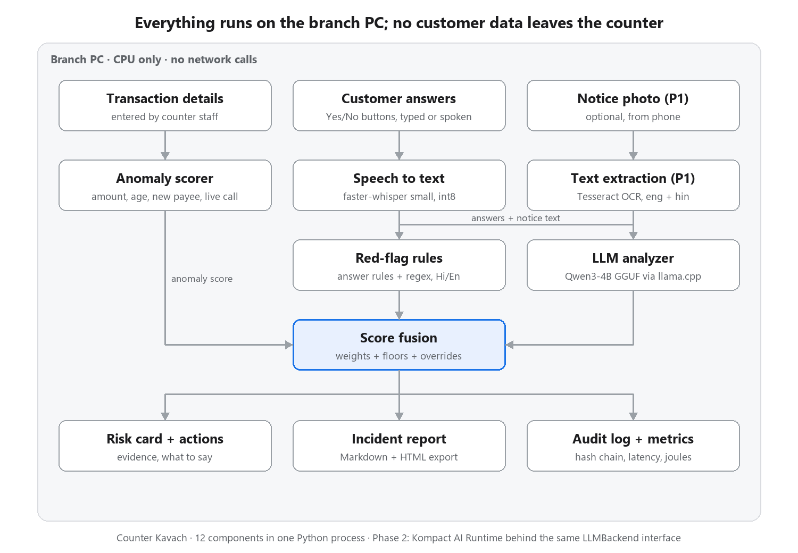

# Counter Kavach

**An offline, CPU-only copilot that helps bank counter staff spot coercion ("digital arrest" and impersonation scams) before a large withdrawal or transfer, and records an SOP-ready incident note.**

- Demo video (2 min): _link to be added_
- Demo GIF: _to be added_ (`docs/demo.gif`)

Everything runs on an ordinary branch PC: no GPU, no cloud API, no customer data leaving the counter. The tool only advises; an authorised officer makes every decision.

## The problem

In a "digital arrest" scam, callers pretending to be police, CBI, ED, customs or RBI keep a victim on a video call for hours or days. They claim the victim's Aadhaar or a parcel is linked to a crime, forbid them from telling anyone, and make them move their savings to a "safe" or "RBI verification" account. Victims are often senior citizens, coached on what to tell bank staff. Central systems can flag accounts, but the money is usually stopped, or lost, **at the branch counter**, by a teller who has a few minutes and no structured way to ask.

Sources (to add before submission; verify each link):
- _Supreme Court of India directions on digital-arrest scams — citation to add_
- _A reported case of branch staff stopping a digital-arrest transfer — citation to add_
- National Cyber Crime Reporting Portal and helpline: https://cybercrime.gov.in, 1930

## What it does

1. **Intake:** staff enter the transaction; an anomaly score (amount vs history, age, new payee, live call at the counter) recommends a check.
2. **Guided check:** ten calm, non-accusatory questions in English or Hindi, with Yes / No / Unsure buttons and a typed or spoken detail box.
3. **Analysis:** red-flag rules (English, Hindi, Hinglish) and a local LLM read the answers. Every LLM quote is checked against what the customer actually said.
4. **Risk card:** LOW / MEDIUM / HIGH with the top evidence and its source, what to say to the customer in their language, and recommended actions. The officer records the decision.
5. **Report:** Markdown and HTML incident note, a 5-line summary to paste into a cybercrime complaint, and a hash-chained audit log.

## What goes in, and where the data comes from

**Transaction details** are typed by the counter staff on the first screen, or filled from a demo scenario. The prototype doesn't connect to any bank system (a deliberate non-goal); in a bank, the history fields would come from the core banking system.

| Field | Example (demo 1) | Source in a real branch |
|---|---|---|
| Customer age | 72 | Core banking system |
| Amount and type (CASH, RTGS, NEFT, IMPS, FD_BREAK, DD, OTHER) | ₹18,00,000 RTGS | Withdrawal / transfer slip |
| Average monthly debit, last 6 months | ₹40,000 | Account history |
| Largest single debit, last 12 months | ₹1,50,000 | Account history |
| New beneficiary? | Yes | Payee list |
| Customer on a phone or video call at the counter? | Yes | What the staff can see |
| Accompanied by an unknown person? | No | What the staff can see |
| Payee account / UPI ID | `SAMPLE-ACCT-…` | Slip (masked unless marked fraud) |
| Staff notes | "anxious, video call open" | Staff |

**Customer answers:** staff ask the 10 questions out loud, press Yes / No / Unsure / Skip, and type or record what the customer says.

**No training data.** Nothing in this project is trained or fine-tuned:

| What | Where it comes from | Used for |
|---|---|---|
| Qwen3-4B-Instruct-2507 (GGUF) | Pretrained, downloaded by `make models` | Reading the answers |
| faster-whisper small | Pretrained, downloaded by `make models` | Speech to text |
| Red-flag rules, questions, actions | Hand-written YAML: `kavach/rules/red_flags.yaml`, `data/question_bank.yaml`, `kavach/actions.yaml` | Detection, interview, advice |
| 40 test scenarios | Synthetic, written for this project: `scripts/make_scenarios.py` → `data/scenarios/*.json` | **Only** for measuring accuracy (`make eval`) |
| Real customer data | None in the repo. At runtime, data stays on the branch PC (`var/`, masked) | The live check |

Each scenario is one made-up customer: transaction fields, answers to the 10 questions, and the correct label (scam type, or genuine).

## Architecture



Typed or transcribed answers feed both the rules and the LLM. Fusion combines the anomaly, rule and LLM scores (weights re-normalised when the LLM is unavailable), then applies **hard overrides** to HIGH (for example, an authority claim plus a threat or a "safe account") and **floors** to MEDIUM (for example, a customer on a live call sending a large amount to a new payee, which catches coached victims who deny everything). The rules + transaction card renders instantly; the LLM refines it.

| Layer | Choice |
|---|---|
| UI | Streamlit (`st.audio_input` for voice) |
| LLM | Qwen3-4B-Instruct-2507, Q4_K_M GGUF, via llama-cpp-python (CPU) |
| Speech to text | faster-whisper small, int8, VAD on |
| Rules | YAML + regex + rapidfuzz, English / Devanagari / romanised Hindi |
| Validation | Pydantic v2 |
| Reports | Jinja2 → Markdown + HTML |

## Quick start

You need Python 3.11 on an x86-64 machine; 8+ cores and 16 GB RAM are recommended. No GPU is needed. The models take about 3.5 GB of disk.

### 1. Install (once)

**Linux / macOS**

```bash
python3.11 -m venv .venv && source .venv/bin/activate
make setup     # pip install -r requirements.txt (prebuilt llama-cpp-python CPU wheel, no compiler needed)
make models    # downloads the LLMs and the Whisper model into models/ (the only step that uses the network)
```

**Windows (PowerShell, with Miniconda)**

```powershell
conda create -n kavach python=3.11 -y
conda activate kavach
python tasks.py setup
python tasks.py models
```

If `conda` isn't recognised, run `& "$env:USERPROFILE\miniconda3\Scripts\conda.exe" init powershell` once and reopen PowerShell. Or skip activation and call the environment's Python directly: `& "$env:USERPROFILE\miniconda3\envs\kavach\python.exe" tasks.py run`.

### 2. Start the app

```bash
make run              # Linux / macOS
python tasks.py run   # Windows
```

When the terminal shows `URL: http://localhost:8501`, open **http://localhost:8501** in a browser; it doesn't open one by itself. Press **Ctrl+C** in the terminal to stop the app. The app always starts with the offline guard on, so the sidebar shows **Offline: network blocked**.

- Port 8501 busy? Use `python tasks.py run --server.port 8502` (or `make run ARGS="--server.port 8502"`).
- Want to click through the screens without the 2.5 GB model? Start it in quick mode, which uses rules and transaction signals only:
  - Linux/macOS: `KAVACH_NO_LLM=1 make run`
  - Windows: `$env:KAVACH_NO_LLM = "1"; python tasks.py run` (clear it with `Remove-Item Env:KAVACH_NO_LLM`)

### 3. Try a demo check

1. In **Load demo scenario**, pick **Demo 1 · digital arrest (Hindi)**. The transaction form fills in, and the anomaly score shows 100/100.
2. Click **Start guided check**, then **Next →** through the 10 questions. The demo answers are already filled in; edit them, or record one with the mic.
3. Click **Analyse →**. The rules + transaction card appears at once; the LLM result replaces it in about 15–60 s. The first analysis also loads the model, which takes a few seconds once.
4. Choose **Action taken**, type the officer's name, and click **Create report →** to see the report, downloads and the complaint summary.

**Demo 3 · genuine wedding payment** shows a LOW result, so the tool doesn't cry wolf.

### Other commands

| Linux / macOS | Windows | What it does |
|---|---|---|
| `make test` | `python tasks.py test` | Unit, model and UI tests |
| `make eval` | `python tasks.py eval` | Runs the 40 scenarios → `eval/results/summary.md` (LLM answers cached; `NOCACHE=1` for fresh calls) |
| `make bench` | `python tasks.py bench` | Fresh-call CPU benchmark → `eval/results/bench.md` (about 15 min; keep the machine idle) |
| `make smoke` | `python tasks.py smoke` | One LLM check on demo 1, with timings |

## Offline and privacy guarantees

- **No network at runtime.** `make run`, `make eval` and `make bench` set `OFFLINE=1`. The guard in `kavach/privacy.py` blocks every non-localhost connection and DNS lookup, and a test proves an outbound call fails. Streamlit usage statistics are off. Models load from local paths only. The sidebar badge shows the guard's state.
- **Synthetic data only.** All scenarios, names and account numbers are invented; there are no agency logos or seals.
- **Minimal data and masking.** Aadhaar, PAN and the customer's account numbers are masked before anything is written to `var/`. Suspect identifiers (payee account, UPI ID, caller numbers) are kept in full only when the officer marks the case as suspected fraud, because the complaint needs them. Audio is never stored. Files in `var/` are deleted after the configured retention period.
- **Human in the loop.** The app never blocks or approves a transaction. HIGH means "do not proceed without the manager"; the action taken and the officer's name are recorded.
- **Fair use of signals.** Age is the only personal attribute scored. Religion, caste, gender, region and language are never risk factors.

## Models and licenses

| Component | License |
|---|---|
| Qwen3-4B-Instruct-2507 (GGUF Q4_K_M) | Apache-2.0 |
| Qwen2.5-1.5B-Instruct (GGUF, optional fallback) | Apache-2.0 |
| faster-whisper small (CTranslate2 conversion of OpenAI Whisper small) | MIT |
| llama.cpp / llama-cpp-python | MIT |
| Streamlit | Apache-2.0 |

Models are downloaded by `scripts/download_models.py` and never committed. Check each model card before redistributing.

## Evaluation results

40 synthetic counter scenarios: 24 scams (10 digital arrest, 5 investment, 4 KYC, 3 relative in trouble, 2 lottery/refund; 5 of them **coached**, where the customer denies everything or gives a cover story) and 16 genuine payments, 7 of them hard negatives (a passport police verification, a High Court land case, a senior on a call with their son paying a new contractor, a courier company's own bill, stamp duty paid into a "government account", and more). English, Hindi (Devanagari) and Hinglish. Split 20 dev / 20 test. The scenarios were committed before the first eval run, and **no weights were tuned afterwards**. Full output: [`eval/results/summary.md`](eval/results/summary.md).

| Metric | Target | Dev | Test | All 40 |
|---|---|---|---|---|
| Scams flagged MEDIUM or HIGH (recall) | ≥ 90% | 12/12 (100%) | 11/12 (92%) | **23/24 (96%)** |
| Scams flagged HIGH | report | 10/12 (83%) | 6/12 (50%) | 16/24 (67%) |
| Coached scams flagged MEDIUM or HIGH | report | 2/2 | 2/3 | 4/5 (80%) |
| Genuine flagged HIGH (false alarms) | ≤ 10% | 0/8 | 0/8 | **0/16 (0%)** |
| Genuine flagged MEDIUM or HIGH | ≤ 30% | 3/8 (38%) | 1/8 (12%) | **4/16 (25%)** |

Ablation on all 40: the fused system is the only configuration that keeps recall high **and** false alarms low.

| Configuration | Scam MEDIUM+ | Scam HIGH | Coached MEDIUM+ | Genuine HIGH | Genuine MEDIUM+ |
|---|---|---|---|---|---|
| **Fused (full system)** | 23/24 (96%) | 16/24 (67%) | 4/5 (80%) | 0/16 (0%) | 4/16 (25%) |
| Without LLM (rules + transaction, floors, overrides) | 24/24 (100%) | 15/24 (62%) | 5/5 (100%) | 1/16 (6%) | 6/16 (38%) |
| Rules only | 20/24 (83%) | 18/24 (75%) | 1/5 (20%) | 0/16 (0%) | 3/16 (19%) |
| LLM only | 19/24 (79%) | 18/24 (75%) | 1/5 (20%) | 0/16 (0%) | 4/16 (25%) |
| Transaction anomaly only | 23/24 (96%) | 15/24 (62%) | 5/5 (100%) | 9/16 (56%) | 13/16 (81%) |
| Baseline: always MEDIUM | 24/24 (100%) | 0/24 (0%) | 5/5 (100%) | 0/16 (0%) | 16/16 (100%) |

- LLM output: valid JSON on the first attempt in 40/40 checks. The evidence guard kept 60 quoted red flags and dropped 1 that wasn't in the answers.
- **Misses, as measured:**
  - `da_10`, scam flagged LOW: a coached customer "buying a plot" while an unknown man answers for him, not on a call. Only the transaction and a declined family call point to it.
  - `gen_04` and `gen_05`, genuine flagged MEDIUM: the passport police verification and the land case. The customer honestly answered Yes to "has anyone said they are from police / a court", and the LLM rated them medium.
  - `gen_07` and `gen_13`, genuine flagged MEDIUM: seniors on a live call with their own child, paying a new payee a large amount. The live-call floor fires by design, and MEDIUM means a supervisor review and a family call, which settles these.

## CPU performance

Measured with `make bench`: 20 test-split scenarios, fresh LLM calls (no cache), model loaded once and system prompt cached, as in the app. Full output: [`eval/results/bench.md`](eval/results/bench.md).

| Item | Value |
|---|---|
| Machine | AMD Ryzen 7 250 laptop (8 cores / 16 threads), 16 GB RAM, **no GPU**, Windows 11 (`bench.md` says "Windows 10": Python's `platform.release()` quirk, since fixed) |
| Model / runtime | Qwen3-4B-Instruct-2507 Q4_K_M, llama.cpp via llama-cpp-python 0.3.36 (AVX2), 8 threads |
| Model load | 3.9 s, once per app start |
| Latency per check | **p50 15.5 s · p95 46.0 s** |
| Prompt processing / generation | 32.3 / 6.7 tokens/s (median) |
| Energy per check | 603 J mean, 377 J p50 (**estimated**: CPU utilisation × 28 W TDP × time; no RAPL on Windows) |
| Energy per 1,000 checks | 167.6 Wh (estimated) |

- Genuine and coached cases take about 14–16 s. Scam cases take 38–60 s, because the LLM quotes the evidence verbatim, and Hindi in Devanagari tokenizes long.
- The rules + transaction card appears instantly (rules ≈ 1 ms), so staff are never waiting on the LLM to start the conversation.
- Speed-ups already applied:
  - model kept loaded
  - static system prompt cached in the KV cache
  - a single LLM call per check
  - bounded output
  - unconstrained first attempt (grammar decoding cost about 0.08 s per token here)
- The Phase 2 Kompact port will be measured against this table.

## Limitations and safety

- Prototype: not certified, not legal advice, and cannot confirm whether a document is genuine.
- The evaluation set is small and synthetic. The scenarios were written by the author (LLM-drafted, hand-reviewed), not taken from real cases, so real-world accuracy is unknown.
- A coached customer who denies everything, isn't on a call and isn't paying a new payee in a large amount can come out LOW. Staff judgement and the "Check anyway" button remain essential.
- On this CPU the LLM step takes 15–90 s; Hindi-heavy answers are the slowest. The rules + transaction card is available immediately.
- Hindi speech recognition with Whisper small is imperfect; transcripts are always editable, and typing is always available.

## Roadmap: Kompact AI Runtime port

All inference sits behind `LLMBackend.generate(messages, json_schema, max_tokens, temperature)`. `KompactBackend` is a stub today; porting it changes one file, and prompts, schemas, the evidence guard and the eval stay identical, so the before/after benchmark is a fair comparison.

1. Week 1: port to Kompact, rerun `make eval` and `make bench`, publish the before/after table.
2. Week 2: more Indian languages (Marathi, Tamil, Telugu, Bengali) for questions and speech.
3. Week 3: one branch server for several counters, request batching, admin view of daily checks.
4. Week 4: test with volunteers playing staff and customers, fix what they hit, record the final demo.

Later: post offices, cooperative banks and Common Service Centres, which handle large cash withdrawals for the same customers.

## License

MIT, see [LICENSE](LICENSE).
